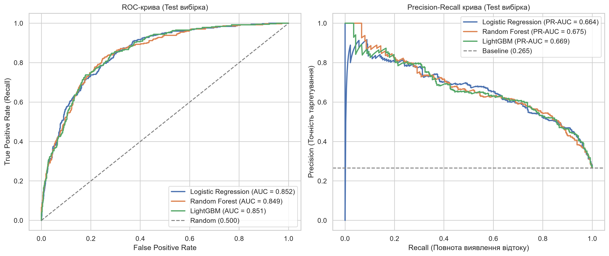
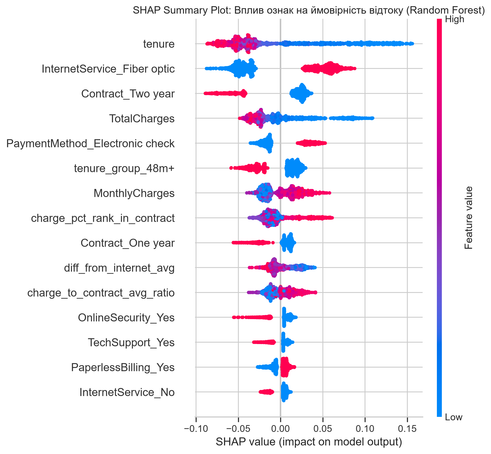

# Customer Churn Prediction Pipeline (SQL + ML + Business Threshold Optimization)

End-to-end проєкт машинного навчання для прогнозування відтоку клієнтів телеком-оператора, побудований на базі локального сховища **SQLite**, інженерії ознак через **SQL (CTE, CASE WHEN, віконні функції)**, пайплайнів **Scikit-Learn** без витоку даних та оптимізації порогу класифікації під матрицю бізнес-витрат.

---

## 1. Бізнес-задача та архітектура рішення

У телеком-індустрії залучення нового клієнта коштує у 4–5 разів дорожче, ніж утримання існуючого. Стандартний поріг класифікації `0.50` не враховує асиметрію вартості помилок: пропуск клієнта, який піде (*False Negative*), коштує значно дорожче, ніж надання знижки лояльному клієнту (*False Positive*).

### Архітектура пайплайна
1. **SQL Ingestion (`src/ingest_data.py`):** нормалізація сирого датасету Telco Customer Churn (7 043 клієнти) у 3 реляційні таблиці в SQLite (`customers`, `services`, `billing`).
2. **SQL Feature Engineering (`sql/extract_features.sql`):** агрегація аналітичної вітрини за допомогою `INNER/LEFT JOIN`, `CTE`, `CASE WHEN` та віконних функцій (`AVG() OVER`, `PERCENT_RANK() OVER`) для розрахунку відносних тарифних показників[cite: 3].
3. **EDA та перевірка гіпотез (`notebooks/01_eda_and_stats.ipynb`):** аналіз дисбалансу класів (26.5% відтоку), критерій Хі-квадрат ($\chi^2$) для категоріальних ознак та U-критерій Манна — Уїтні для числових показників[cite: 3].
4. **ML Pipeline (`src/train.py`):** об'єднання `ColumnTransformer` (`StandardScaler` + `OneHotEncoder`) та класифікатора в єдиний `Pipeline` для запобігання витоку даних (*Data Leakage*) на 5-фолдовій стратифікованій крос-валідації[cite: 3].
5. **Оптимізація порогу та інтерпретація (`notebooks/02_modeling_and_cv.ipynb`):** мінімізація сукупних витрат компанії ($C_{\text{retention}} = \$20$, $C_{\text{churn}} = \$100$) та аналіз факторів ризику через **SHAP**[cite: 3].

---

## 2. Порівняння моделей (Test Set)

Оскільки вибірка має дисбаланс класів (73.5% / 26.5%), основними метриками якості обрано **ROC-AUC** та **PR-AUC** (*Average Precision*)[cite: 3].

| Модель | Test ROC-AUC | Test PR-AUC | Особливості |
| :--- | :---: | :---: | :--- |
| **Random Forest** *(фінальна модель)* | **0.8521** | **0.6788** | Найкращий баланс узагальнення та ранжування ризиків[cite: 3] |
| **Logistic Regression** | 0.8515 | 0.6634 | Сильний лінійний бейзлайн завдяки SQL-ознакам[cite: 3] |
| **LightGBM** | 0.8404 | 0.6479 | Базова конфігурація градієнтного бустингу[cite: 3] |

### Криві якості класифікації (ROC та Precision-Recall)


---

## 3. Бізнес-оптимізація порогу та SHAP-інтерпретація

### Оптимізація порогу під матрицю витрат
Замість стандартного порогу `0.50` виконано пошук порогу $t^*$, що мінімізує функцію витрат[cite: 3]:

$$\text{Total Cost}(t) = (TP(t) + FP(t)) \cdot \$20 + FN(t) \cdot \$100$$

Зниження порогу класифікації дозволяє виявити більшу частку клієнтів у зоні ризику та суттєво скоротити фінансові втрати бізнесу порівняно зі стандартним порогом `0.50` (точні параметри збережено у `models/model_metadata.json`)[cite: 3].


### Ключові драйвери відтоку (SHAP Summary Plot)


**Ключові інсайти для бізнесу:**
* **Тип контракту (`Contract_Month-to-month`):** найсильніший тригер відтоку — клієнти з помісячною оплатою мають найвищий ризик уходу, тоді як довгострокові контракти (1–2 роки) надійно утримують аудиторію[cite: 3].
* **Стаж клієнта (`tenure`):** найбільший ризик припадає на перші 12 місяців користування послугами[cite: 3].
* **Технологія підключення та чек (`InternetService_Fiber optic`, `charge_to_contract_avg_ratio`):** користувачі оптоволокна та клієнти, чий рахунок перевищує середній чек у їхньому сегменті, частіше схильні до зміни оператора[cite: 3].

---

## 4. Структура проєкту

```text
customer-churn-prediction/
├── data/                    # Локальна БД SQLite та сирі/оброблені дані (ігноруються Git)
├── sql/
│   └── extract_features.sql # SQL-запит з JOIN, CASE WHEN та віконними функціями
├── notebooks/
│   ├── 01_eda_and_stats.ipynb    # EDA та статистичні тести (Хі-квадрат, Манна — Уїтні)
│   └── 02_modeling_and_cv.ipynb  # Порівняння моделей, оптимізація порогу та SHAP
├── src/
│   ├── config.py            # Єдина конфігурація шляхів, ознак та бізнес-параметрів
│   ├── ingest_data.py       # Завантаження CSV у нормалізовані таблиці SQLite
│   ├── make_dataset.py      # Збірка аналітичної вітрини з SQLite
│   ├── train.py             # Навчання пайплайна, валідація та збереження моделі
│   └── predict.py           # Пакетний інференс та сегментація ризиків утримання
├── models/
│   └── model_metadata.json  # Зафіксовані метрики та оптимальний бізнес-поріг
├── reports/figures/         # Візуалізації для аналізу та документації
└── requirements.txt         # Залежності проєкту
```

---
## 5. Інструкція запуску

```text
1. Клонування репозиторію та налаштування середовища:

Bash
    git clone [https://github.com/](https://github.com/)<твій-нікнейм>/customer-churn-prediction.git
    cd customer-churn-prediction
    python -m venv .venv
    source .venv/bin/activate  # Для Windows PowerShell: .venv\Scripts\Activate.ps1
    pip install -r requirements.txt

3. Підготовка даних (покласти telco_churn.csv у data/raw/):
 
  Bash
    python -m src.ingest_data
    python -m src.make_dataset

4. Навчання моделі та оптимізація бізнес-порогу:

  Bash
    python -m src.train

5. Генерація списку клієнтів для утримання:

   Bash
     python -m src.predict
   
